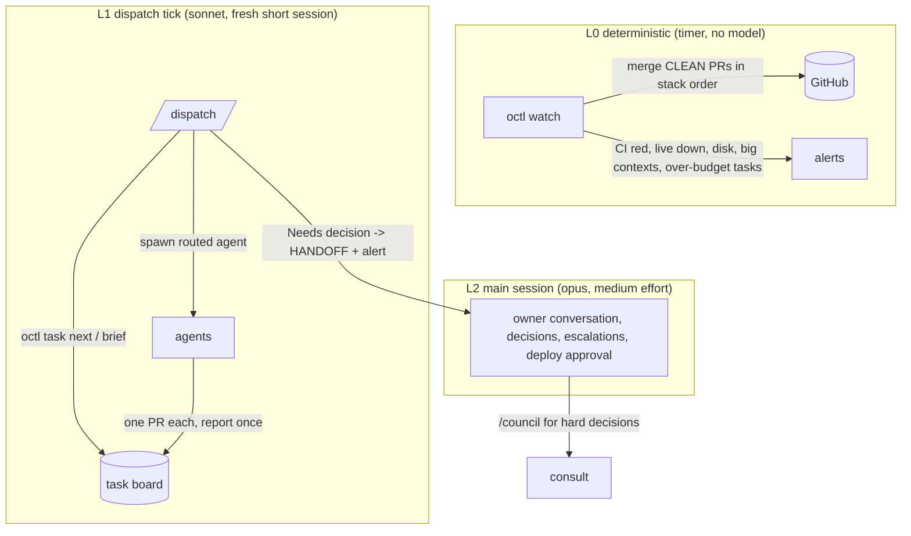

# orchestrator-kit: an orchestration kit for Claude Code

Run software development with several Claude Code agents without burning tokens or losing control:
model routing, a staged workflow with gates, a task board with resource reservations, a merge-queue
watcher with alerts, guarded deploys, safety hooks, token budgets, and an advisor council for decisions.

It works two ways:

- **Plugin** (`orchestrator-kit`): agents, skills, hooks and `bin/octl` + `bin/consult` on the Bash PATH.
- **Project template**: `./init.sh /path/to/repo` scaffolds `.claude/`, `CLAUDE.md`, `octl.json`, briefs
  and a handoff file into a repository. Nothing to install.

Requirements: Claude Code (tested with 2.1.293), Python 3.10+, `git`, and `gh` for GitHub features.

## First 10 minutes

```bash
git clone https://github.com/openctemio/orchestrator-kit && cd orchestrator-kit
python3 -m unittest discover -s tests -p "test_*.py"     # 56 tests, a few seconds

# Option A - template (recommended to start; you can read and edit every file)
./init.sh /path/to/your/repo
cd /path/to/your/repo
$EDITOR octl.json CLAUDE.md          # repo, base_branch; project, commands
./.claude/bin/octl route --kind feature --risk high      # see the routing
./.claude/bin/octl task add P1 change "Fix the login redirect" --size S
./.claude/bin/octl brief T001        # the brief an agent will get
claude                               # session starts with octl status in context
#   then: /dispatch  (starts T001 with the routed agent and model)

# Option B - plugin
claude plugin marketplace add openctemio/orchestrator-kit
claude plugin install orchestrator-kit@openctem-kit
# copy templates/octl.json to your repo root (set "agent_prefix": "orchestrator-kit:")
# and merge templates/settings.json (permissions, status line) into .claude/settings.json
```

Then: `octl install-timer` prints a systemd user timer for the L0 watcher (`--write` installs the unit files;
enabling it is up to you), and `docs/cheatsheet.md` is the one-page reference.

## Layout

```
.claude-plugin/plugin.json, marketplace.json   plugin manifest (validated with claude plugin validate --strict)
agents/        scout (haiku, read-only), rebaser (sonnet), fixer (sonnet), implementer (opus), reviewer (sonnet, read-only)
skills/        dispatch, workflow, unjam, token-audit, handoff, deploy, council, agent-briefing,
               verify-before-done, pr-review-sweep, merge-queue-stacks, security-first-design,
               safe-live-db-query, silent-failure-sweep, ui-consistency, merge-queue-keeper,
               security-ack-review, ci-failure-triage, ui-device-qa, third-party-evaluation,
               measure-then-decide
hooks/         hooks.json + scripts: guard-bash.py, guard-mcp.py, session-status.sh
bin/octl       supervisor: board, routing, gates, reservations, watcher, tokens, deploy, timer (stdlib Python)
bin/consult    advisor council (stdlib Python)
statusline/    statusline.py: model, context tokens, BIG CONTEXT warning
templates/     CLAUDE.md, nested-CLAUDE.md, settings.json, BRIEF-common.md, octl.json, HANDOFF.md, mcp.json
examples/      openctem/ (a real multi-agent host config + live hook scripts), council-providers.json
docs/          routing.md, workflow.md, tools-and-mcp.md, council.md, cheatsheet.md
tests/         unit tests + an end-to-end dry-run scenario and a lint of agents/skills/JSON
init.sh        template scaffolder (idempotent, never overwrites without --force, never deletes)
```

## Architecture



- **Routing** (`docs/routing.md`): kind x risk x size -> agent, model, effort, max turns, token budget.
  Two failures escalate one tier; follow-ups start fresh at their own tier.
- **Workflow** (`docs/workflow.md`): intake -> plan (opus) -> implement -> verify -> review -> ci -> queue ->
  deploy -> handoff, with gates octl checks (design note, PR recorded, CLEAN + 0 threads, merged, verified).
- **Safety** (`docs/tools-and-mcp.md`): per-agent tool lists, deny/ask/allow permissions, guard hooks for Bash and
  MCP, secrets never read into transcripts, outward actions need a human.
- **Token discipline**: why it matters and what to do is in `templates/BRIEF-common.md` ("Token budget"),
  enforced by budgets, the status line warning, `octl tokens` and the watcher.
- **Council** (`docs/council.md`): blind advisors in parallel, optional second round, synthesis, audit log.

## Daily workflow

1. `octl status` (or read the SessionStart summary), `octl task next`.
2. `/dispatch` starts free slots with fresh agents (or `octl spawn ID --run` headless).
3. Agents report once; `/workflow ID` moves a task through review, CI and queue.
4. `octl unjam` (or the timer) merges clean PRs; `/unjam` turns blocked PRs into rebaser tasks.
5. `/deploy` when the owner asks; `/handoff` before ending a long session.

## Practice skills

Besides the orchestration skills, the kit ships skills that encode lessons from running many agents on one
product. Claude loads each one only when its description matches the work:

| Skill | Use it when |
|---|---|
| `verify-before-done` | before any commit, push or "done": build, tests, fail-before test, functional check, CI |
| `pr-review-sweep` | before marking a PR ready: fix, reply to and resolve every human and bot thread |
| `merge-queue-stacks` | stacked PRs or migration-numbered PRs going through a squash merge queue |
| `security-first-design` | designing or reviewing routes, queries, integrations, jobs in a multi-tenant system |
| `safe-live-db-query` | any query against a production database |
| `silent-failure-sweep` | bug hunts and audits: features that are wired but never run |
| `ui-consistency` | UI fixes: fix everywhere through shared components, measure instead of eyeballing |
| `agent-briefing` | writing a brief for a subagent (pairs with `templates/BRIEF-common.md`) |
| `merge-queue-keeper` | keeping many PRs flowing: rolling window, enqueue only clean PRs, never touch queued entries |
| `security-ack-review` | re-approving a PR after its security label dropped: review the change since the last approval |
| `ci-failure-triage` | red checks: newest run per workflow, real vs flake vs stale, queue-only failures |
| `ui-device-qa` | screenshot bug reports: reproduce on device profiles, measure overflow and overlap |
| `third-party-evaluation` | "should we use X": verify claims in code, supply chain, fit, borrow vs adopt |
| `measure-then-decide` | redesign questions: numbers from the live system first, then options and decisions |

## Nested CLAUDE.md

Keep the root `CLAUDE.md` short: it loads into every session. Put area rules in `<dir>/CLAUDE.md`
(`templates/nested-CLAUDE.md`); Claude Code loads those only when it works on files in that directory.
Procedures belong in skills (loaded on demand), not in CLAUDE.md.

## Configuration (`octl.json`)

| Key | Meaning |
|---|---|
| `repo`, `base_branch`, `merge_queue`, `merge_method` | GitHub repository; with `merge_queue: false`, unjam sets auto-merge |
| `max_agents`, `ctx_warn`, `disk_min_gb` | concurrency cap, big-context line, disk alert |
| `routing` | overrides for the routing tables (`docs/routing.md`) |
| `state_dir`, `work_dir`, `workspaces_file`, `hold_file` | board and ledgers, agent workspaces, optional workspace registry, PRs never to merge |
| `brief_common`, `handoff_file` | common brief path, handoff file (deploys append a line) |
| `transcripts_dir` | default: `~/.claude/projects/<project path with non-alphanumerics as ->` |
| `agent_prefix` | `orchestrator-kit:` for the plugin, `""` for agents in `.claude/agents` |
| `spawn_args` | extra `claude -p` args for `octl spawn`, e.g. `["--permission-mode", "auto"]` |
| `ports`, `migrations` | port range; migration dir + filename regex + width + gap |
| `ci_ignore`, `keep_containers` | workflow names that never make CI red; container prefixes that are not scratch |
| `alerts` | env var names: `telegram_token_env`, `telegram_chat_env`, `webhook_url_env` (https only); optional `env_file` |
| `live` | shell hooks: `checkout`, `health`, `version`, `rehearse {sha}`, `apply {sha}`, `verify`, `stop`, `start`, `destructive_regex` |
| `council` | advisors, providers, budgets (`docs/council.md`) |

`octl deploy apply` refuses unless that exact commit passed `octl deploy rehearse`, stops the service only when a
new migration matches `destructive_regex`, and always restarts it.

## Verified, and what is left out

Verified against the docs (code.claude.com/docs) and the installed CLI 2.1.293:
plugin manifest and layout (`claude plugin validate --strict` passes for plugin and marketplace; `claude plugin
details` lists 15 skills, 5 agents, 2 hook events, about 1,670 always-on tokens); plugin `bin/` on the Bash PATH;
agent fields (`tools`, `disallowedTools`, `model`, `effort`, `maxTurns`, `color`); skill fields (`description`,
`argument-hint`, `arguments`, `disable-model-invocation`); hook events, matchers, `permissionDecision`
deny/ask and SessionStart `additionalContext`; status line input (`context_window.*`); settings `model`,
`effortLevel`, `permissions.allow/ask/deny`, `statusLine`; `.mcp.json` `${VAR}` expansion; `claude -p` flags
used by `octl spawn` and `consult`; Messages API structured output shape.

Left out on purpose:
- Hook `onFailure` (needs CLI 2.1.295+) and hook `if` filters (the guard scripts do their own matching).
- Plugin `userConfig` and `experimental.monitors`: configuration lives in `octl.json`, and the watcher is a
  timer so it also runs when no session is open.
- A plugin cannot set the status line; it ships in the template settings (copy it for plugin installs).
- Agent `isolation: worktree`: agents make their own git worktree inside their workspace, so worktrees stay
  where the workspace rules expect them. Turn it on per agent if you prefer the built-in isolation.
- `--max-turns` is not a `claude -p` flag in 2.1.293; turn limits come from agent `maxTurns` and the brief.
- Agent-CLI council presets other than `claude` are unverified (not installed); see `examples/council-providers.json`.
- The MCP package names in `templates/mcp.json` were not run; check them before enabling.

## Security

See `SECURITY.md` (report to security@openctem.io). Short version: hooks are a safety net, not a sandbox;
secrets come only from environment variables; outward and irreversible actions stay with humans.

## License

Apache License 2.0 - see `LICENSE`.
