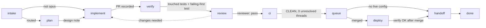

# Workflow stages and gates

Every task on the board moves through the same stages. `octl task advance ID` moves it one stage when the
gate passes and prints the reason when it does not. `--force` skips a gate and is logged; use it only with a
human's yes.

| Stage | Owner | Gate checked by octl |
|---|---|---|
| intake | orchestrator (`octl task add`) | routing done |
| plan | implementer (opus tasks only) | design note exists (`<state_dir>/notes/<ID>.md`): problem, approach, threat model, tests |
| implement | routed agent, one git worktree in its own workspace, one PR | `octl task pr ID N` recorded |
| verify | same agent | PR recorded (the agent reports the touched tests and a test that fails without the change) |
| review | reviewer agent, read-only, security lens | PR recorded (verdict recorded by the orchestrator) |
| ci | same agent as implement | every PR is CLEAN, not draft, and has 0 unresolved review threads |
| queue | `octl unjam` / `octl watch` | every PR merged |
| deploy | owner-approved, `deploy` skill | a successful `octl deploy verify` after the last merge (skipped when `live` is not configured) |
| handoff | orchestrator | none (one line in the handoff file) |

Board status is separate from the stage: `todo` (waiting for a slot), `doing` (counts against `max_agents`),
`blocked`, `done`. `octl task fail` sends a task back to `todo` and re-routes it (two fails escalate).

## Resource locks

- **Workspace**: each task works in `<work_dir>/<task-id>/`, one git worktree per PR. Never the live checkout.
- **Migration numbers**: `octl mig reserve ID N` takes the next block above the base branch, every open PR and
  earlier reservations, rounded up to leave a gap.
- **Ports**: `octl port reserve ID N` picks ports that are free on the host and not reserved by another task.
- `octl release ID` drops a task's reservations. All state writes are serialized with a file lock.

## Stop conditions (in every brief)

An agent stops and reports when the PR is green and clean, its budget or turn limit is near, the same gate
failed twice, it needs a decision, or the next step is outward-facing or irreversible (merge, release, deploy,
delete data, message people). Those actions stay with humans.
